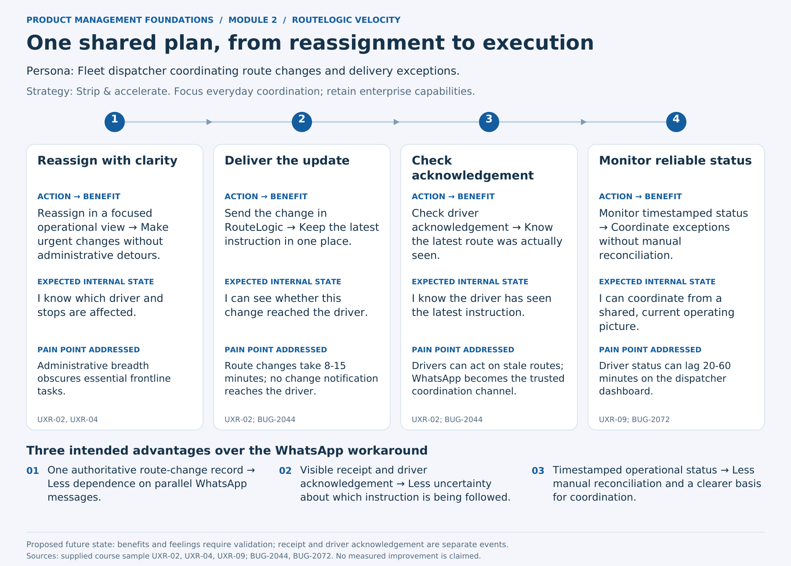

# RouteLogic Velocity - Future-State Journey Map

Module 2 - Exercise 2 | Proposed design, not a validated outcome

[Open the one-page PDF](journey-map.pdf)

**Persona:** Fleet dispatcher coordinating route changes and delivery exceptions.  
**Goal:** Keep drivers following the latest route and coordinate from trustworthy operational status.  
**Strategy:** Strip & accelerate - focus the operational workflow while retaining advanced enterprise capabilities.  
**Primary evidence:** UXR-02 and UXR-09, corroborated by BUG-2044 and BUG-2072 in the [course sample](routelogic-sample-data.md).

## Four stages

1. **Reassign with clarity**

   - Reassign in a focused operational view → Make urgent changes without administrative detours.

   **Expected internal state:** "I know which driver and stops are affected."

   **Pain point addressed:** Administrative breadth obscures essential frontline tasks.

   **Evidence:** UXR-02, UXR-04.

   **Design detail:** A focused view is proposed; the sample does not establish the exact current reassignment navigation.

2. **Deliver the update**

   - Send the change in RouteLogic → Keep the latest instruction in one place.

   **Expected internal state:** "I can see whether this change reached the driver."

   **Pain point addressed:** Route changes take 8-15 minutes; no change notification reaches the driver.

   **Evidence:** UXR-02; BUG-2044.

   **Design detail:** Show pending, received, or failed transport honestly. Receipt does not prove the driver read the change.

3. **Check acknowledgement**

   - Check driver acknowledgement → Know the latest route was actually seen.

   **Expected internal state:** "I know the driver has seen the latest instruction."

   **Pain point addressed:** Drivers can act on stale routes; WhatsApp becomes the trusted coordination channel.

   **Evidence:** UXR-02; BUG-2044.

   **Design detail:** The driver is a supporting actor who opens and acknowledges the latest route. The dispatcher remains the journey persona.

4. **Monitor reliable status**

   - Monitor timestamped status → Coordinate exceptions without manual reconciliation.

   **Expected internal state:** "I can coordinate from a shared, current operating picture."

   **Pain point addressed:** Driver status can lag 20-60 minutes on the dispatcher dashboard.

   **Evidence:** UXR-09; BUG-2072.

   **Design detail:** Freshness and timestamps must reflect real system state; a cosmetic label does not resolve delayed synchronization.

## Three intended competitive advantages over the manual workaround

- One authoritative route-change record → Less dependence on parallel WhatsApp messages.
- Visible receipt and driver acknowledgement → Less uncertainty about which instruction is being followed.
- Timestamped operational status → Less manual reconciliation and a clearer basis for coordination.

These are proposed benefits, not measured wins against WhatsApp or a named competitor. Each action-benefit statement contains no more than 15 words, excluding the arrow.

## Validation boundary

The intended feelings are design hypotheses, not additional interview findings. The current-workaround sequence is reconstructed from sample evidence rather than directly observed end to end. Timely transport, explicit acknowledgement, and trustworthy status need technical validation; a prototype alone cannot prove them. This focused journey does not claim to resolve the separate crash, offline-access, routing-relevance, or photo-upload issues identified in Exercise 1. No delivery-speed target, adoption lift, or renewal improvement is asserted.
