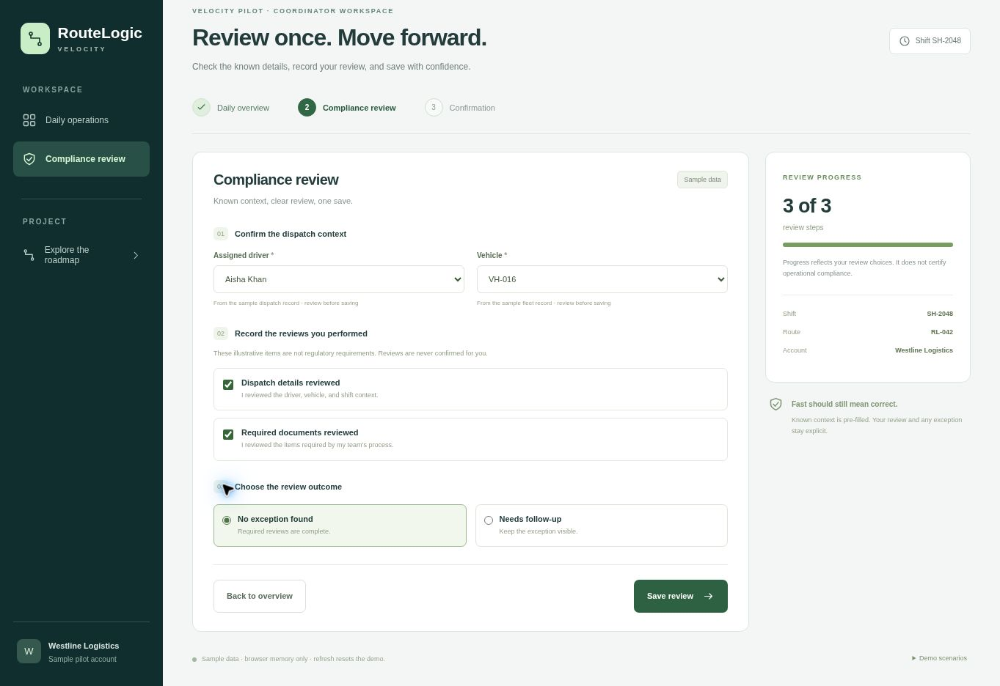

# PRD & Prototype Sprint (Module 4)

**Project:** RouteLogic Velocity  
**Author:** Saad Binnffal  
**Top Now feature:** B1, with B5 as a small supporting component.

## Pick & scope with MoSCoW

- **The “Now” feature I'm scoping (name + one-line core description):** **B1 One-Click Compliance Checklist**, narrowed to a guided compliance review: show known context, require explicit human review, record exceptions, and save with accurate feedback. “One-click” does not mean automatic certification.

### Final MoSCoW

| Category | Requirements and reason |
| --- | --- |
| Must | Focused entry; known driver/vehicle context with missing-data validation; explicit unchecked reviews; explicit outcome and exception note; invalid-save blocking; honest local save/failure/retry state; a single saved receipt; distinction between saved and unsaved edits. Removing any of these undermines completing or trusting the core review. |
| Should | B5 section progress and concise source/field guidance. Implemented because the small prototype can accommodate them; core review remains possible without them. |
| Could | Additional visual polish, keyboard-efficiency refinements, and optional nonessential guidance after basic usability is proven. |
| Won't now | AI-generated authoritative facts or automatic approval; full dashboard rebuild; notification backend; handoff wizard; PDF export; training system; login, external APIs, and durable storage. |

- **My finalized Must-Haves (after overriding the AI):** The Must row above is the final scope audit. It keeps truthful completion, failure recovery, and record integrity as part of core value rather than treating them as polish.
- **What I demoted from Must → Should/Won't, and why:** Section progress is Should because a user can complete the primary review without it. PDF export and a full training system are outside this version; underlying valid records and concise help are different requirements. AI approval and broad dashboard work are Won't because they introduce a different problem and complexity. These are explicit scope decisions, not a claim of a separate Claude run or engineering approval.

## Generate your Simplified PRD

- **Full PRD:** [simplified-prd.md](simplified-prd.md). It follows the requested Header / Big Picture / Details / Logistics structure, with three user stories, exactly three screens, eight functional requirements, two decision-log choices, and three evals.
- **One thing my PRD makes explicit that a vague brief would have missed:** Prefill supplies known context, not a completed human review. Required checks start unchecked, and a saved exception stays open instead of being presented as a clean completion. FR7 also distinguishes edits from the last saved record.

## Prompt-to-prototype sprint

- **Where did the prototype reveal a gap in my PRD logic? (what I had to update):** In actual browser QA, saving a review, editing the driver, and returning to Overview left the first version labeled Reviewed. I clarified FR7, added Unsaved Changes / Continue Editing states, and rechecked that the prior receipt remains unchanged until the next valid save. I also defined section progress so an exception without its required note is not counted complete.
- **My prototype, as a link or a screenshot:** [Working offline prototype](prototype.html) · [Overview screenshot](prototype-overview.jpg) · [Review screenshot](prototype-review.jpg) · [Confirmation screenshot](prototype-confirmation.jpg) · [Exception variant](prototype-exception.jpg).

### What is actually functional

Three-screen navigation; sample-data prefilling; allowed driver/vehicle choices; explicit review controls; field errors; conditional exception note; section progress; local save simulation; one-shot save-failure/retry; saved receipt; and unsaved-edit feedback. React is bundled into the HTML and UI state uses useState only. No login, CDN, external API, or live service is required.

### Verification and limits

16 deterministic validation fixtures and eight additional receipt/progress assertions passed. Desktop browser QA observed invalid-save blocking, valid completion, missing context, required exception note, save failure with preserved inputs, successful retry to an open-exception receipt, and the corrected unsaved-edit state. Roadmap card details, scoring/cut views, and CSV download were also exercised.

The interface includes responsive CSS, but mobile-device usability and the five-coordinator timed study have not been performed. This prototype cannot validate the M3 30% production-time target, retention, or real regulatory compliance. Use a comparable baseline and a suitable pilot/experiment for those claims.

## Cohort-channel debrief draft

My biggest aha was that prefill should remove repeated effort without pretending a human review is complete. The hardest part was keeping saved, unsaved, failed, and exception states honest; testing exposed an edit-after-save gap that I added to the PRD and fixed.

## Files to commit

Commit both Module 4 Markdown guides, simplified-prd.md, roadmap.html, prototype.html, and the referenced screenshots together under 04-roadmap so relative links work. Uploaded HTML may need to be downloaded and opened locally or hosted; GitHub's source preview is not the running app.

Prepared with ChatGPT using the supplied course samples. The screenshot route is included, so an instructor does not need access to a private preview link to inspect the work.
