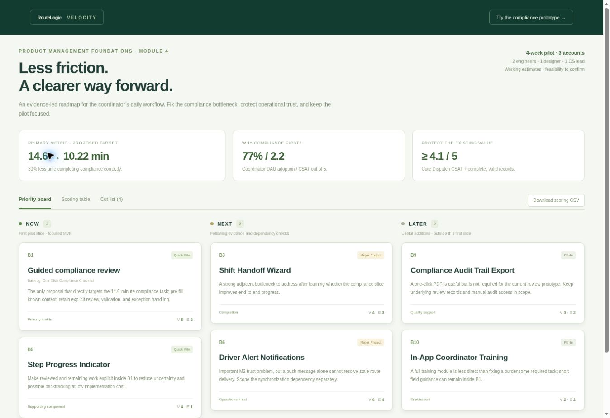

# Roadmap, PRD & Prototype (Module 4)

**Project:** RouteLogic Velocity (B2B)  
**Author:** Saad Binnffal  
**Constraint:** 2 engineers + 1 designer + 1 CS lead; a four-week pilot across three accounts. Engineering estimates and production feasibility remain to be confirmed before the pilot clock starts.

## Your strategic anchors

- **Persona (M2), who are you solving for?:** A frontline fleet coordinator / dispatcher managing the daily dispatch-to-handoff workflow for a regional delivery fleet.
- **Primary success metric (M3), your leading indicator:** A proposed 30% relative reduction in mean correctly completed compliance-task time: 14.6 to at most 10.22 minutes, after validating a comparable baseline. The target is not an observed result.
- **Moment of misery (M2), the specific friction blocking the goal:** M2 documents delayed route changes, stale status, and a WhatsApp workaround [UXR-02, UXR-09; BUG-2044, BUG-2072]. M3 narrows the first improvement bet to compliance: 77% coordinator-DAU adoption, 2.2/5 coordinator CSAT, and 14.6 minutes against a 3-minute benchmark. The M2 interviews do not directly describe the compliance task; its precise cause needs observation.
- **Guardrail metric (M3), what must not drop or break:** Preserve coordinator Core Dispatch CSAT at 4.1/5 and prevent deterioration in the completeness and validity of required records. Existing manager reporting remains available; removing required checks is not an acceptable source of speed.

## Scan the backlog & set a human baseline

- **My instinctive “quick wins” before touching the AI (2 to 3 feature IDs + why):** The worked pre-scoring shortlist is **B1, B5, B6**: a focused compliance form targets the largest task-time gap; a small progress component can clarify remaining work; route-change alerts appear initially simple and match M2's explicit pain. The final audit keeps B1 + B5 in Now, but moves B6 to Next because synchronization is a substantive dependency.

**Method honesty:** This is an AI-assisted worked solution prepared in one ChatGPT conversation. The shortlist, initial AI scores, and evidence-led revisions below are explicit reasoning stages, not a record of an independent human baseline or a separate Claude/new-chat run. The student should review and adopt or amend the judgments.

## Scoring rubric and finalized table

Value 1 = negligible relevance to this pilot; 5 = directly targets the M3 primary metric. Effort 1 = a small implementation measured in days; 5 = major multi-month complexity. Working quadrant boundaries are **high Value 4-5** and **low Effort 1-2**. These explicit boundaries support this artifact; they are not claimed to be the course builder's undocumented internal formula.

Effort includes implementation, integration, and testing under the stated reuse assumptions; these are provisional PM estimates, not engineering sign-off. Quadrants do not remove dependencies or automatically decide sequencing.

| Feature | Initial AI V / E | Final V / E | Quadrant | Decision | Evidence-led rationale |
| --- | --- | --- | --- | --- | --- |
| B1 - One-Click Compliance Checklist | 5 / 3 | 5 / 2 | Quick Win | Now | The only proposal that directly targets the 14.6-minute compliance task; pre-fill known context, retain explicit review, validation, and exception handling. |
| B2 - Smart Daily Report Auto-Fill | 4 / 2 | 3 / 4 | Time Sinker | Cut | Daily reporting has a real gap, but generative report population is outside the selected compliance-time bet and adds data-integrity and integration complexity. |
| B3 - Shift Handoff Wizard | 3 / 3 | 4 / 3 | Major Project | Next | A strong adjacent bottleneck to address after learning whether the compliance slice improves end-to-end progress. |
| B4 - Mobile-First Coordinator Dashboard | 5 / 3 | 3 / 4 | Time Sinker | Cut | A full cross-workflow dashboard rebuild is too broad for the current task-level hypothesis. A responsive prototype is not a claim that B4 has been delivered. |
| B5 - Step Progress Indicator | 2 / 1 | 4 / 1 | Quick Win | Now | Make reviewed and remaining work explicit inside B1 to reduce uncertainty and possible backtracking at low implementation cost. |
| B6 - Driver Alert Notifications | 4 / 2 | 4 / 4 | Major Project | Next | Important M2 trust problem, but a push message alone cannot resolve stale route delivery. Scope the synchronization dependency separately. |
| B7 - Contextual AI ETA Display | 4 / 3 | 1 / 4 | Time Sinker | Cut | No supplied evidence links an inline ETA display to lower compliance-task time; avoid a new prediction surface in this pilot. |
| B8 - Fleet Analytics Manager View | 4 / 3 | 1 / 4 | Time Sinker | Cut | A new executive analytics view does not target coordinator compliance friction. Preserve existing manager reporting rather than add a new build. |
| B9 - Compliance Audit Trail Export | 4 / 2 | 3 / 2 | Fill-In | Later | A one-click PDF is useful but is not required for the current review prototype. Keep underlying review records and manual audit access in scope. |
| B10 - In-App Coordinator Training | 3 / 2 | 2 / 2 | Fill-In | Later | A full training module is less direct than fixing a burdensome required task; short field guidance can remain inside B1. |

### Assumptions that protect the estimate

- B1's Effort 2 applies only to a thin, deterministic review flow using an existing trustworthy record model and reusable validation/save capability. If these are unavailable, re-estimate and narrow; do not promise production delivery from a fast prototype build.
- B5 is a component inside B1, not a second independent platform project. Its lower-confidence benefit must be tested; do not add its supposed lift to B1's.
- B6's notifications depend on reliable transport and current route state. A notification UI alone cannot fix the supplied 8-15-minute reassignment delay.
- The B3 backlog describes approximately 6.8 minutes saved, but M3 only supplies an 11.3 vs 4.5-minute benchmark gap. That gap is an opportunity, not a measured feature effect.
- B7's 11% usage figure refers to drivers; coordinator usage is 23%. Neither is an all-user adoption rate.
- B9's export is distinct from required record integrity. No legal mandate for this exact PDF format is supplied; confirm any actual obligation before deferring it.

## Audit, override & decide

- **Where did you override the AI? (feature + old vs. new score + why):**
- **B1:** Effort 3 → 2 only for the constrained, deterministic review slice; automatic approval and new AI infrastructure are excluded.
- **B2:** Value 4 → 3; Effort 2 → 4. Do not assume AI can populate authoritative operational facts.
- **B3:** Value 3 → 4 based on funnel and timing evidence; keep Next to avoid combining two new workflows in the first test.
- **B4:** Value 5 → 3; Effort 3 → 4. Protect the pilot from a full workspace rebuild.
- **B5:** Value 2 → 4 as a small support to the selected workflow; confidence is lower than B1 and must be tested.
- **B6:** Effort 2 → 4 because transport and synchronization, not only UI notifications, determine usefulness.
- **B7:** Value 4 → 1; Effort 3 → 4 relative to this metric, rather than rewarding AI novelty.
- **B8:** Value 4 → 1; Effort 3 → 4. Sales origin is not sufficient priority evidence.
- **B9:** Value 4 → 3. Separate required record integrity from an optional export format.
- **B10:** Value 3 → 2 for the current pilot; do not substitute training for an unresolved workflow problem.
- **Did the AI over-value a Sales/Eng request your M2 interviews don't support?:** The illustrative baseline overvalues the new B8 executive analytics view (Value 4 to 1). M2 says reporting already delivers value, and M3 manager Reporting CSAT is 4.5/5; neither establishes demand for an additional dashboard that improves coordinator compliance time. B7 also loses priority because no supplied evidence ties inline predictions to this primary metric. Preserve existing reporting and predictions rather than deleting them.
- **Did it underweight something your M3 cohort/funnel data strongly supports?:** The audit raises B3 Value 3 to 4 because handoff takes 11.3 minutes vs 4.5 and only 31% of workflow starters reach it. B5 rises 2 to 4 as a low-effort supporting hypothesis around the compliance transition (71% reach assignment; 48% complete compliance). RouteLogic provides role, funnel, and CSAT snapshots, not a time-based retention-cohort table.

## Generate your interactive roadmap

- **My “Now” lane (this sprint), the 2 to 3 quick wins I'll build first:** **B1 + B5**, implemented as one focused review flow. B1 is the top feature taken into Lab 2; B5 is a small Should-Have support inside it.
- **Next:** **B3 Shift Handoff Wizard; B6 Driver Alert Notifications**, following observations and dependency checks.
- **Later:** **B9 Compliance Audit Trail Export; B10 In-App Coordinator Training**. Basic valid records, manual audit access, and concise field help remain supported; this defers a PDF generator and full training system.
- **What I cut, and the “no” I'm protecting the scope from:** **B2, B4, B7, B8** in their proposed broad forms. Exclude generative report population, a full coordinator workspace redesign, a new predictive-ETA surface, and a new executive dashboard from the compliance pilot. Cut means not now; reconsider if the evidence, obligation, or scope changes.
- **Prototype/roadmap screenshot link (paste into your deliverables):** [Interactive roadmap](roadmap.html) · [Roadmap screenshot](roadmap.jpg) · [Three-screen prototype](prototype.html) · [PRD and prototype lab](prd-and-prototype.md).

### Capacity and sequencing

Use the current pilot for the core B1+B5 problem, not a mechanically exact 70/20/10 allocation. This small team must first validate the existing core value. Later portfolio planning can rebalance core, adjacent, and exploratory capacity. No unapproved dates or independent production savings are committed.

### Lab 1 reflection

The key judgment was separating a superficially simple feature from its dependencies: B6 looks like a quick notification, but M2 shows delayed shared state. B1 earns the first test because compliance-time, adoption, and satisfaction evidence converge, while B5 remains a small testable support rather than a proven cause of the drop-off.

## Sources

M2 supplied UXR/bugs and the selected coordinator persona; M3 hypothesis-and-metrics.md and RouteLogic Snapshots 1-3; M4's provided B1-B10 backlog and team constraints. All source metrics are classroom examples; score revisions and targets are planning judgments.
